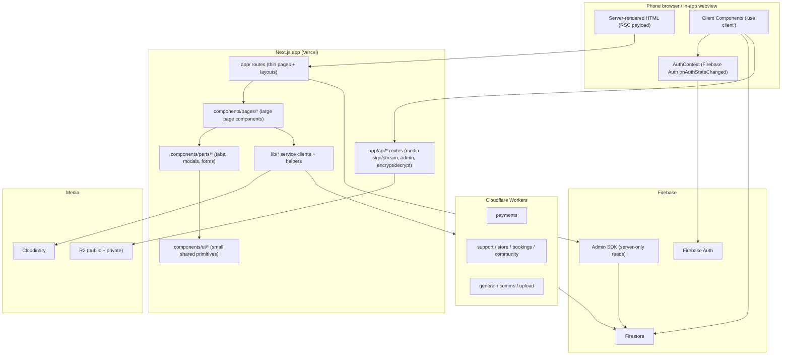

# Architecture — current state (Phase 0)

Snapshot of `agaseke/` on branch `feat/mobile-ui-refactor`, taken before any UI
changes. Source of truth is the code, not this document. File references use
`path:line`.

## 1. Stack

| Layer | What is used |
|---|---|
| Framework | Next.js **16.1.3**, App Router, React **19.2.3**, Turbopack dev |
| Language | TypeScript 5, `strict: true`, path alias `@/* -> ./*` |
| Styling | Tailwind CSS **v4** (`@import "tailwindcss"`), CSS variables in `app/globals.css`, `next-themes` for light/dark |
| Auth | Firebase Auth (Google provider), `auth/AuthContext.tsx` |
| Data | Firestore (client SDK in client components, Admin SDK in server components) |
| Media | Cloudinary + Cloudflare R2, signed private-media proxy |
| Payments | 4 domains through `workers/payments`: MTN MoMo / Airtel Money (Paypack), cards (Pesapal) |
| Other workers | `bookings`, `comms`, `community`, `general`, `store`, `support`, `upload` |
| Hosting | Vercel (app), Cloudflare Workers (domains) |
| Analytics | Google Analytics via `@next/third-parties` in the root layout |

## 2. High-level diagram

## 3. Directory map (app code only, excludes `workers/`)

| Folder | TS/TSX files | Notes |
|---|---:|---|
| `app/` | 104 | Route groups: `(main)`, `(public_profile)`, `(authentication)`, `(dashboards)/creator`, `(dashboards)/supporter`, `(dashboards)/admin`, `(legal)`, plus `api/` |
| `components/pages/` | 59 | One large component per screen (e.g. `SupporterSpace.tsx` **2,012 lines**, `AdminPage.tsx` **1,626**, `SettingsPage.tsx` **1,120**) |
| `components/parts/` | 76 | Tab bodies, modals, dashboard forms, layout |
| `components/ui/` | 7 | Only `ConfirmModal`, `DetailSkeleton`, `LinkifyText`, `NotificationDrawer`, `RichContentRenderer`, `TabErrorState` |
| `lib/` | 34 | Service clients, auth middleware, media signing, formatting helpers |
| `auth/` | 3 | `AuthContext`, `AuthGuard`, `LoginRedirectCapture` |
| `types/` | 8 | Domain interfaces (creator, booking, store, community, …) |
| **Total** | **326** | **55,428 LOC** |

No `features/`, no `hooks/` directory, no shared design-token module, no test
directory in the app.

## 4. Code-shape facts

| Fact | Count | Why it matters |
|---|---:|---|
| Files marked `"use client"` | **112** of 326 | Interactivity is pushed high, not to leaves |
| `any` occurrences | **492** (63 explicit `eslint-disable no-explicit-any`) | Typed service layer is not enforceable yet |
| Raw `fetch(` calls in components/pages | **47** | Calls are scattered; `lib/apiClient.ts` is not the only path |
| Files importing `firebase/firestore` or `firebase/auth` directly | **90** | Business logic and data access live in components |
| `orange-*` Tailwind utilities | **1,399** | No token indirection; restyling is a find-and-replace |
| `text-[10px]` / `[11px]` / `[9px]` / `[8px]` / `[7px]` | 284 / 21 / 6 / 2 / 1 | Text below the 12 px floor is systemic |
| `@/` aliased imports | everywhere | Alias already configured in `tsconfig.json` |

## 5. Data flow and state

- **Auth/identity:** single React context (`auth/AuthContext.tsx`). Reads
  `profiles/{uid}` and `creators/{username}` via `onSnapshot`, exposes
  `user`, `profile`, `creator`, `isCreator`, `isAdmin` (custom claim).
- **No global data store:** no Redux, Zustand, React Query or SWR. Every screen
  fetches in `useEffect` and keeps local `useState`.
- **Server components:** home (`app/(main)/page.tsx`) and the public creator page
  (`app/(public_profile)/[username]/page.tsx`) read Firestore through the Admin
  SDK and pass serialized data into large client components.
- **Everything else is client-fetched:** explore, dashboards, supporter area,
  store, bookings, community, messages.
- **Realtime:** `onSnapshot` is used for notifications, transaction status
  (`SupportModal.tsx:160`), dashboard creator settings, and chat.
- **Caching:** `revalidate = 300` on home and public creator page. No
  on-demand revalidation, no route-level `Cache-Control` policy in the app.

## 6. Firebase usage

| Path | Role |
|---|---|
| `db/firebase.ts` | Client singleton: `initializeApp`, `getAuth`, `getFirestore`, `getStorage`, optional App Check. Eagerly imported by any client component that needs it. |
| `db/firebaseAdmin.ts` | Server-only lazy Admin SDK proxy (cert from env). Used by SSR pages and API routes. |
| `app/api/media/sign` | Checks entitlement (creator, admin, existing supporter relationship) and returns a post-scoped HMAC signature. |
| `app/api/media/stream` | Verifies signature/expiry, re-checks the key belongs to the post, streams bytes with `Cache-Control: private`. |
| `lib/usePostMediaSrc.ts` | Client hook: resolves private media through the signed proxy, caches grants per user/post. |
| `lib/mediaAccess.ts`, `lib/mediaSigning.ts` | Entitlement + signing helpers. |

Firestore reads/writes are otherwise done directly from components through the
client SDK. Collections seen in code include `creators`, `profiles`,
`creatorContent`, `supportedCreators`, `transactions`, `creatorGatherings`,
`creatorGiveaways`, `creatorPartners`, `storeProducts`, `storeOrders`,
`communityTiers`, `communitySubscriptions`, `notifications`, `payouts`,
`creatorIncome`, `currencies`, `countries`.

## 7. Payments (UI-relevant)

- Client entry points: `lib/paymentsService.ts` (`initiateMomoPayment`,
  `initiateCardPayment`) and `lib/paymentsService.ts` retry helpers.
- Support UI is a **single monolithic modal**:
  `components/parts/public/SupportModal.tsx` (493 lines) with four `step`
  values: `input` → `processing` → `success` / `error`.
- MoMo: user enters phone, client opens a Firestore `onSnapshot` on
  `transactions where ref == data.ref` and waits up to **120 s**
  (`SupportModal.tsx:178`), then shows a timeout error.
- Card: `window.open(data.redirect_url, "_blank")` **after an await**
  (`SupportModal.tsx:247`). In WhatsApp/Facebook webviews this is blocked; a
  fallback link exists only on the error screen.
- The pay button has no double-submit guard beyond `isSubmitting`, which is only
  set for the card path.
- Server-side amount/fee authority and webhook correctness are handled by the
  payments workers (see `docs/PAYMENTS.md`); this UI refactor must not change
  payment logic.

## 8. Styling and design tokens

- Tokens today are only the small `:root` / `.dark` block in `app/globals.css`
  (background, foreground, card, border, muted). There is **no spacing, radius,
  type scale, shadow or brand token set**.
- The brand shown in code is **orange** `#ea580c` / `#f97316`, not the red
  `#FF0000` named in the brief. This must be confirmed before changing brand
  colour (see Questions for the founder).
- Fonts: Rubik via `next/font/google`, `font-display` default. `body` also sets
  `font-family: Arial, Helvetica, sans-serif`, conflicting with `*` Rubik.
- Dark mode is class-based via `next-themes`; several screens use hardcoded
  light-only colours (`bg-amber-50`, `bg-green-50`, `text-orange-600`).
- Arbitrary spacing/type is common (`text-[10px]`, `p-1.5`, fixed `h-48`).

## 9. Navigation today

| Audience | Current navigation |
|---|---|
| Public / fan | `components/parts/Navigation.tsx` top bar (logo, Explore/Posts/Help/Blog on desktop, account dropdown, theme toggle, notifications). Public creator page adds `TabManager` as a **fixed bottom bar** (`TabManager.tsx:42`). Logged-in users additionally see `MobileBottomBar` (Feed / Creator / Discover / Admin / Feedback) on `lg:` and below. |
| Creator | `components/parts/dashboard/Layout.tsx`: desktop sidebar + mobile hamburger drawer; top header with theme, feedback, notifications, account dropdown. No bottom tabs. |
| Supporter | `/supporter` (`SupporterSpace.tsx`), same top bar + `MobileBottomBar`. |
| Admin | `app/(dashboards)/admin/layout.tsx` + `admin-nav`. |

The public profile and the logged-in shell therefore render **two independent
fixed bottom bars** in some states, and the creator area has no bottom-tab
navigation at all.

## 10. Screen map

See `docs/screens/INVENTORY.md` for the full role-by-role inventory (~70 routes).

## 11. Current performance and quality baseline (from the 1 Nov audit)

Measured on production, mobile Lighthouse:

| Page | Perf | LCP | TBT | CLS | JS | Transfer |
|---|---:|---:|---:|---:|---:|---:|
| Creator `/[handle]` | 19 | 6.0 s | 4,730 ms | **0.906** | 4.6 MB | 10.2 MB (7.1 MB images) |
| Home | 65 | 2.6 s | 3,630 ms | 0.065 | 1.8 MB | 1.7 MB |
| Login | 42 | 6.5 s | 3,380 ms | 0.003 | 1.5 MB | 1.3 MB |

Additional evidence:

- Creator page throws **React #418** (hydration text mismatch) on every load:
  `audit/artifacts/perf/chromium-mid-android.json` (`pageErrors`).
- axe mobile: creator has `button-name` (critical ×3), `color-contrast`
  (serious ×10), `link-name` (serious ×7), `target-size` (serious ×2).
- 36 tap targets under 44 px at 360 px width:
  `audit/artifacts/usability/tap-targets-360.json`.
- At 400 kbps the creator page did not finish loading in 90 s.

## 12. Environment constraints found in Phase 0

- `agaseke/.env` exists but **every Firebase value is empty** (it is a blank
  template). `NEXT_PUBLIC_API_KEY`, `NEXT_PUBLIC_PROJECT_ID`, `FIREBASE_*` are
  length 0. The app cannot boot (`auth/invalid-api-key`, Admin `app` missing).
- There is **no Firebase emulator config** (`firebase.json` / `.firebaserc` /
  emulator ports) in the repo, and no seed data.
- There is **no app-level test suite**: no Playwright config, no unit tests, no
  CI lint/typecheck workflow in `agaseke/`. The only Playwright suite is the
  read-only audit in `../audit/`.
- No test accounts, no staging project, no provider sandbox credentials.
- Consequence: Phase 0 screenshots and authenticated flows cannot be produced
  until an emulator + seed data (or staging credentials) are provided. This is
  recorded as a blocker in `docs/screens/before/README.md`.

## 13. Coupling rules that the restructure must preserve

- `docs/PAYMENTS.md`: initiation is server-authoritative; the client sends
  identifiers only. UI must not reintroduce `amount`, `productPrice`,
  `creatorUid`, fee or referral fields for store/booking/gathering/community.
  Support/gift amount is the one user-entered amount.
- Private media must keep going through `/api/media/sign` → `/api/media/stream`
  (`lib/usePostMediaSrc.ts`). Never render a bare private asset URL.
- Admin is a custom claim (`auth/AuthContext.tsx:58`), not a client-writable
  profile field. UI must not read `profiles.isAdmin`.
- Firestore rules are out of scope. UI dependencies are recorded in
  `docs/RULES_FOLLOWUP.md`.
